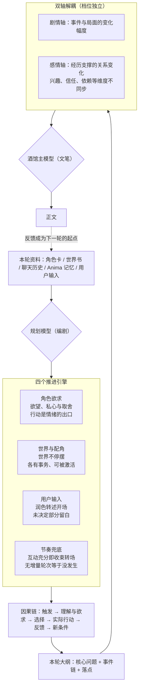

# Vespera

SillyTavern 双模型扩展：读取当前输入、角色卡、世界书、聊天历史和 Anima 本轮有效记忆，由独立规划模型完成这一轮的故事设计，再交给酒馆当前主模型重新创作完整中文正文。

当前版本 **0.2.52，测试版**。已进行本地模拟测试与浏览器界面检查，尚未完成真实酒馆、Anima 服务和中转 API 的联调。模拟验证不能替代实际版本、手机键盘与文学效果试读。

0.2.52 新增独立的 **V3 实验大纲**（规划预设 0.7.0，content-v3.0），V1／V2 协议与内置预设保持不变，已有方案和已生成大纲不会被覆盖。V3 只使用 background / characters / direction：background 交接必要局面与认知边界；每位重点人物必须填写 state / change / choice，尤其要写清具体触发、旧感受、新感受、并存矛盾及其对选择的影响，不能用“承前”“不变”“无实际变化”略过情感演化；direction 只写情感、关系和剧情的持续推进方向。V3 不再提供 beats、anchors、end_state，不列【口吻】或逐拍事件。具体事件、人物互动、线上消息、查看资料、群像介入、场景转换、人物口吻、停点和结尾由主模型依角色卡、世界书、聊天历史与主预设自然生成。使用时在 **预设 → 管理 → 恢复 V3 实验** 建立独立副本，并把主预设中的承接条目替换为新版 `presets/writer.txt`；V3 主模型承接与旧版不同，不能只替换 XML 模板。文学效果仍需同场景对照试读，不预设 V3 优于 V1／V2。

0.2.51 针对实机日志中的 `writer.receipt.rejected: prefix-changed` 修正正文回执快照范围：可见聊天文字、角色名、描述、人格、场景、示例、提示词覆盖及剧情相关卡面字段仍严格比对；收藏状态、聊天文件名和其他扩展写入角色卡的运行数据不再导致回执失效。真正的聊天或角色故事字段变化仍会拒绝沿用。封存失败日志新增 `source=chat / character / persona / cardOverrides` 等安全分类，不记录正文内容。新增运行元数据与真实故事修改两组回归检查；本机实日志对应的精确变化字段未能从现有日志确认，修复结果仍需实机复测。无需恢复规划预设或修改主预设。

0.2.50 将正文实现职责完全交还主预设和主模型（V1 规划预设 0.5.2，V2 规划预设 0.6.2；XML 协议不变）。两套内置预设只交接世界与局面前提、人物状态、情感及认知变化、关键选择、事件因果、信息变化和结束状态；删除强制第三人称、开场润色转述、整体视点与视点切换、正文呈现顺序、叙述重心、结尾写法及镜头等指令。user 补写档位只限制可新增的故事内容，不再控制视点。V1 的 plot / characters / segments / end_state 与 V2 的 direction / beats / anchors / end_state 外壳保留，字段语义改为故事设计；writer.txt 明确主模型不是逐项扩写或润色大纲，而是理解故事事实与因果后重新创作完整正文，人称视点、开场、结构、详略、环境、心理、对白、氛围、节奏、承接和结尾均依主预设独立决定。事件结果、情感及认知因果、关键选择、信息边界、用户重大决定、人物既有口吻与逐字文本仍受大纲约束。两套内置预设同时删除「世界书格式与页面呈现」条目及输出模板中的【呈现】交接，不再由大纲决定消息卡片、社交平台页面等组件的开关、位置、字段、模板或排版；发消息、发帖、写信等仍作为剧情事实和必要内容规划，大纲未提组件不代表省略格式。旧 V1／V2 大纲及旧【呈现】标记仍可解析、净化和生成正文。已有安装和自定义副本不会被改写；使用新版规则需重新「恢复 V1 稳定」或「恢复 V2 实验」建立副本，并更新主预设中的 writer.txt 承接条目。文学效果与主预设兼容性仍需真实酒馆试读。

0.2.49 同时保留两套完整的内置规划预设：**V1 稳定**（规划预设 0.5.1，content-v1.2）沿用原有 plot / characters / segments / end_state 结构；**V2 实验**（规划预设 0.6.1，content-v2.0）采用 direction / beats / anchors / end_state 结构，侧重核心事件、情绪因果与必要选择。新安装默认使用 V1；已有安装升级后继续保留当前已保存方案，不会自动切换。需要对照时，在 **预设 → 管理** 分别点击「恢复 V1 稳定」或「恢复 V2 实验」，每次都新建独立副本，不覆盖自定义预设；选择只影响下一次规划，已生成的大纲仍按自身版本解析、净化与扩写。V2 是否改善生动性、灵活性和实际文学效果仍待酒馆试读，不预设其优于 V1。

同版本修复宿主只补写 swipe_id 等滑动元数据时正文回执被误判失效的问题：回执仍严格比较聊天可见文字、角色资料和上下文，但忽略这类元数据；用户输入实际变化时仍拒绝复用。该路径已通过本地回归测试，用户此前在真实酒馆遇到的 no-receipt 根因尚未实机确认。若仍失败，运行日志会记录 reply-missing、prefix-changed、floor-changed 等封存原因，便于继续定位。

0.2.48 收回大纲对群像的控制职责（规划预设 0.6.1，输出契约仍为 content-v2.0）。删除“首轮、新场景或多人关系网必须至少激活一名既有人物”的硬指标、思考阶段的强制群像盘点，以及 writer.txt 的「群像与世界活性」整节。相关人物如何出场、互动、分配视点与戏份由主预设和主模型负责；只有某人的独立行动已经成为核心因果、会改变关键事件、信息或结束状态时，才把这项行动写入节拍。大纲未提及仍不等于禁止补充。使用新版内置内容需再次在 **预设 → 管理 → 恢复内置** 建立新版副本，并将主预设承接条目替换为新版 writer.txt；已有自定义方案不会被自动覆盖。

0.2.47 将内置规划预设升级到 0.6.0，输出契约升级为 content-v2.0，旧版大纲仍可读取、展示、净化与扩写。新结构以 direction 交代本轮核心变化，以 beats 的 event / emotion / choice 分别锁定外部事件、心理因果和必要的核心选择，以 anchors 集中交接关键事实、信息边界、口吻和特殊格式，以 end_state 锁定结束局面。普通对白、日常互动、环境外貌、视点停留、过渡、非核心小事件与最后镜头默认由主模型创作，大纲未提不等于禁止；结尾默认只锁状态，不锁最后一个动作或镜头。群像盘点提前到思考阶段：首轮、新场景或已有多人关系网时，至少让一名有相关事务的既有人物凭自身目标行动并影响场面，不能自动收缩成双人戏。正文配套条目 writer.txt 同步改写，允许同大纲重 roll 改变实现而不只是换措辞，并保留独立格式义务和旧版 content 兼容。当前仅完成同场景的新旧结构对比与本地自动化验证，实际群像丰富度、文学效果和原卡首轮表现仍需在酒馆中试读。使用新版内置内容需在 **预设 → 管理 → 恢复内置** 建立新版副本；主预设里的配套条目需手动替换为新版 writer.txt，已有自定义方案不会被自动覆盖。

0.2.46 修复同一聊天重新载入后正文回执因消息对象被替换而失效的问题：楼层、聊天前文均未变化且原始正文候选仍完整保留时，可重新绑定回执并继续在同楼层左右滑动生成候选，不重复规划或召回 Anima；原始候选被改写、真正切换聊天或页面刷新后仍须重新生成正文。正文交接同时明确：【呈现】只交接组件内容与位置，不是组件开关；角色卡、世界书或主预设要求的线上聊天、消息卡片、小红书等格式，在大纲未声明时仍按各自触发条件生成。规划预设版本保持 0.5.1，无需恢复内置。

0.2.45 内置规划预设新增「破限｜头部创作许可（按需开启）」（预设版本 0.5.1）。参考 55O 头部破限中减少过度拒绝、允许成人与禁忌虚构的核心创作许可，去除模型专属身份、输入伪装及与剧情无关的规则，改写为适合规划端的中文条目。条目位于「01 本轮任务与资料」组、紧跟主任务条目，**默认关闭**，需要时手动开启；允许黑暗、背德、禁忌、强制控制、暴力、成人亲密与欲望等虚构题材按人设和因果如实规划，不额外添加道德评判、免责声明或说教，也不把创作许可变成强迫人物行动。明确硬边界与平台限制仍保留；本条只影响规划许可，不输出正文、不改变 content XML 输出合同。使用新版内置内容需在 **预设 → 管理 → 恢复内置** 建立新版副本，再到该组开启条目并保存；已有自定义方案不会被覆盖。

0.2.44 情绪强度改为事件级杠杆，新增触发式爆发与活人反应（预设版本 0.5.0）。此前 150% 仍显淡的根因：档位尾句写「强度缩放角色自己的表达方式」，而大纲是刻意说明文化的——表达归正文模型，规划端几乎没有可缩放的东西；且「内敛者的浓体现在暗涌密度」给了模型逃生门，任何角色都被读成内敛，浓只停在内心。现在四档尾句改为「强度同时决定情绪在事件、行动与余波中的权重并缩放其表达」：150% 要求情绪的层次必须改变互动（第二反应成为新的触发、掩饰失败漏出破绽、余波改变下一步条件），浓必须落在可写的事件、动作与对白上，暗涌只是附加层、不能是全部；200% 允许情绪压过理智（明知道不该、还是做了）；50% 的克制也要留下可辨认的痕迹。「03 情感与关系」新增按需条目「爆发｜触发式情绪失控」：五类触发（不可逆失去、外力夺取失控、认知击碎、核心创伤重叠、极端反转）成立时必须爆发且有行动后果（语言崩裂、失态、收不回来的事），内心翻涌只能作前奏；不触发不强迫，不替用户作重大决定。常驻「情感｜触发、判断与反馈」新增【活人反应】：允许答非所问、口是心非、突然转移话题、明知不合适仍去做的小冲动——活人感常在这些错位里。档位互斥与默认动态判定不变，已启用状态保留。使用新版内置内容需在 **预设 → 管理 → 恢复内置** 建立新版副本。

0.2.43 净化可用性三件套与规划容错（预设版本不变，仍为 0.4.9，无需恢复内置）。**净化模型可测试**：「大纲净化」新增「测试净化模型」按钮，复用规划接口与密钥发最小请求验证模型可用；净化模型输入框接入候选列表，与「规划连接」拉取的模型列表共享。**净化前后对比**：净化运行后，大纲页出现「净化前后对比」折叠区——净化前的规划原文与净化后的改写文本逐段对照，顶部标明结果（已采用·结构校验一致／结构不一致已回退／请求失败已回退），回退时也保留净化模型实际返回供核对；重新生成或切换聊天时清空。**规划偶发格式错误自动重试一次**：规划模型返回的 XML 标签未正确配对（CONTENT_INVALID，模型偶发多写闭合标签一类错误）时自动重试一次，第二次仍失败才按原方式显示「最近失败响应」；其他类型错误不重试。另澄清：0.2.39 起净化请求失败本就只回退原大纲并写运行日志，不会弹出失败响应——在大纲页看到的 CONTENT_INVALID 失败响应来自规划请求本身，而非净化。净化相关设置仍为执行开关，不参与回执签名。

0.2.42 基调分组十四条重命名，类别与组合规则一目了然（预设版本 0.4.9）。此前十四条都叫「基调｜××」，分不清哪些同类、哪些互斥、哪些可叠加。现在按「类别·名称（规则）」命名：**题材**六条——题材·权谋博弈／悬疑揭示／闯关规则／惊悚血腥／冒险探索／日常生活流，标注（可叠加），条目内容同步声明同组题材可叠加、规则冲突时以更契合本轮场景者为主；**情感**六条——情感·酸涩／恨海情天／浪漫拉扯／甜蜜治愈／压抑沉郁／轻松喜剧，标注（可叠加），多种情感层次并存时分别落实；**弧线**两条——弧线·悲剧向／圆满向，标注（二选一），沿用原有互斥声明。条目标识符、内容与启用状态不受影响，只是名字与组合规则更清楚。使用新版内置内容需在 **预设 → 管理 → 恢复内置** 建立新版副本。

0.2.41 新增「故事巡检」（预设版本不变，仍为 0.4.8，无需恢复内置）。纯本地规则检测、不调用模型，在大纲页顶部给出停滞提示，默认开启。三条保守规则：一、连续数轮正文几乎没有新信息（新人物、地点、物件、事件），判定为剧情空转——基线是该层之前的全部聊天，被转述的用户输入不算新信息；二、本轮大纲与上一楼已写大纲的核心问题相同、结尾状态无实质变化（上一楼大纲取自正文回执，不受滑动多版本影响）；三、长聊（十二楼以上）且「档位」「基调」分组从未启用任何条目——整组被手动关闭视为主动选择，不提示。连续轮数阈值（2—5）可在配置页调整。巡检结果只显示在大纲页顶部，不进入任何请求；点击「带入下次规划」才把提示作为一次性备注注入下一轮规划请求（位于当前输入之前，规划模型可按剧情实际采纳或忽略），生效一轮后自动清空，不常驻、不累积。两个设置均为执行开关，不参与回执签名，切换不会让已生成的大纲失效。

0.2.40 预设新增「基调」分组（预设版本 0.4.8）。故事基调影响的是规划端"写什么"：事件来源、冲突力学、代价分布、揭示节奏与长线收束——句式与文风仍归主预设。十四条按需条目可自由组合（如 权谋＋酸涩＋悲剧向），分三层：**题材结构**六条——权谋博弈（信息差与筹码，推进靠布局不靠巧合）、悬疑揭示（每轮一条可核对线索，疑问同步加深）、闯关规则（规则内博弈，失败留真实代价）、惊悚血腥（威胁有杀伤重量，安全区缩小）、冒险探索（旅程结构，挑战—收获循环）、日常生活流（不要外部危机，戏剧性来自人物本身）；**情感基调**六条——酸涩（接近与错过并存，克制多于宣泄）、恨海情天（爱恨同源，不安排轻易原谅）、浪漫拉扯（靠近—退开循环，每次退开有新理由）、甜蜜治愈（伤口被看见，善意落实为具体照顾）、压抑沉郁（出口稀少，希望小剂量且有代价）、轻松喜剧（冲突来自错位而非恶意，代价可逆）；**弧线方向**两条互斥——悲剧向（不可逆代价，伏笔朝"来不及"兑现，局面逐级收窄）、圆满向（修复与重逢，代价真实但不以失去作结）。全部关闭时规划维持现状，按场景性质自然发展。使用新版内置内容需在 **预设 → 管理 → 恢复内置** 建立新版副本。

0.2.39 大纲语言双保险与 user 补写四档（预设版本 0.4.7）。**大纲净化**：配置页新增「大纲净化」——填写净化模型并开启后，规划完成会由这个快速模型（复用规划接口与密钥）把大纲改写为平实直述，只改语言、不改内容：事实、决定、因果、信息边界、XML 字段结构、【呈现】【口吻】【逐字保留】标记全部保留，逐字原句一字不动；改写结果须通过结构与标记校验才会采用，失配或请求失败自动沿用原大纲。净化属于执行开关，不参与回执签名——切换不会让已生成的大纲失效。**源头净化**：交付协议新增说明文规则——情绪用可核对的词直陈（不写"钝感被一句称呼撬开"式短语）、程度写满（"略占主动"，不用"三分"式量化修辞）、细节用事实写法（不写"空得像白纸"式鉴赏形容）、态度直陈，与既有句式禁令并列。**user 补写四档**：「档位」分组新增 弱／轻度／强／很强 四条互斥条目——弱档只转述输入、外加维持在场的即时小反应；轻度即现有默认；强档让 {{user}} 作为共主体持续在场、日常表态与往来节奏可代行；很强档近似全权共演，高密度对白与内心，只有重大决定（承诺、决裂、关系升级、关键站队、透露重要信息、非常态转移）留给用户。全部未启用时维持轻度默认；任何幅度下影响剧情与关系走向的决定都留给用户，「输入复述与轻度抢话」条目的补写幅度改由档位决定。使用新版内置内容需在 **预设 → 管理 → 恢复内置** 建立新版副本。

0.2.38 大纲不再附「必须遵守」清单（预设版本 0.4.6，输出契约 content-v1.2）。end_state 只保留「本轮状态」——执行后的局面、实际变化、停点与未完成条件；结尾落点由停点与最后一拍交付，认知与信息边界写在其发生事件的「信息变化」中，角色卡、世界书与聊天上文的既有约束由主模型直接读取，大纲不复抄、不另立清单。逐条生成的规则清单会让扩写僵化，且其中大部分主模型本来就从卡面资料读得到；思考链对规则适用前提的核对保留（前提不成立的禁令本轮不启用），只是不再把结论写成清单交付。主模型配套条目（writer.txt）同步改写：落实 end_state 停点、未完成条件与各事件标明的认知边界，兼容仍带「必须遵守」的旧大纲。使用新版内置内容需在 **预设 → 管理 → 恢复内置** 建立新版副本；主预设里的配套条目需手动替换为新版 writer.txt。

0.2.37 预设新增「场外事件」三档（预设版本 0.4.5）。「档位」分组新增三条互斥开关：场外事件·仅当前场景（本轮只写在场人物，场外不插入消息、到访或突发）、场外事件·允许到场（场外事态可作为交汇来源进入本轮，但只提供信息与契机，不改写核心矛盾方向）、场外事件·影响主线（场外事态可直接冲击本轮核心矛盾，到时机的线索与后果优先兑现）。三条全部关闭时维持「世界不停摆」的常态——场外世界照常运转，是否进入本轮由场景性质决定。任何档位下伏笔与持续状态都照常累积，差别只在场外事态进入本轮的程度。分组随之改名「档位｜推进、情绪与场外」。使用新版内置内容需在 **预设 → 管理 → 恢复内置** 建立新版副本。

0.2.36 规划端可读取其他扩展的注入内容（预设版本不变，仍为 0.4.4，无需恢复内置）。伏笔、状态栏类扩展（如自动推进伏笔、召回生理状态与待办的插件）通过酒馆标准接口把内容注入正文请求，主模型看得到，但规划模型的独立请求此前完全看不到——大纲可能与这些已成立的事实脱节。现在配置页新增「其他扩展 → 读取其他扩展的注入内容」开关（默认关闭）：开启后，规划请求会把当前聊天中非空的扩展注入按其在正文请求中的位置与深度排序带入，标注为「本轮已成立的资料」，规划沿用其中事实，注入的格式与写法要求仍归主模型执行；Vespera 自己的大纲注入永远排除，总量超过两万字时截断并标注。该开关参与回执签名——切换后旧大纲不再复用，需重新规划。「检查提示词」的来源清单同步新增「其他扩展注入」一项，显示未开启 / 已读取 / 已读取·无注入三种状态。

0.2.35 消除档位重复控制（预设版本 0.4.4）。剧情推进与感情推进此前同时存在两套入口：配置页「正文目标」里的两个下拉（写入插件共享配置、随正文目标注入）和预设「档位」分组的开关条目，两处文案还略有差异，容易设了一处忘了另一处。现在**只保留预设档位条目这一处**：配置页移除两个下拉，「正文目标」只剩字数上下限；共享配置不再携带任何推进档位，思考链「节奏判定」的优先链相应简化为"用户输入指定 > 启用的档位条目 > 按场景性质判定 > 默认沉浸—慢速"。8 条档位条目与「可选｜正文目标」条目中对共享配置的引用同步移除；情绪强度档位本来就没有配置项，不受影响。旧的存档与备份里若保存过这两个设置项，清洗时直接丢弃、不报错；字数目标行为不变。配置页「正文目标」下新增一行说明，指向预设页的「档位｜推进与情绪强度」分组。使用新版内置内容需在 **预设 → 管理 → 恢复内置** 建立新版副本。

0.2.34 放宽 {{user}} 代写范围并澄清场景转换归属（预设版本 0.4.3）。**代写范围**：此前「输入复述与轻度抢话」的选择范围把"转往新场景"等日常流动也列为禁区，导致 {{user}} 的日常视角无法展开。现在【允许补写】明确：{{user}} 的视点节点与日常片段可以成段呈现，包括其与其他人物的日常往来、应酬、闲谈与协作，这些互动沿用 {{user}} 已确立的性格、口癖与当前态度，不引入改变局面的新事实、不替其建立或破坏重要关系。【选择范围】相应收窄为真正的禁区：只有影响剧情走向与关系走向的回答与决定保留给用户（重要承诺、原谅或决裂、亲密关系升级、关键站队与表态、透露或隐瞒重要信息等）；日常流程中的应答、礼貌回应、事务性往来与例常安排不属于重大决定，可由大纲安排。语境中等同于重大接受的点头、沉默或短答仍不属于轻度补写。**场景转换**：明确场景收束与转换是剧情安排而非替用户作决定——当前互动的判断与反馈已充分、本场没有继续展开的价值时，应当收束本场并转入下一时空或引入新事件，不拖场、不靠原地加码延长；{{user}} 是否同行、如何到达按例常逻辑或其输入处理，只有非常态的、改变剧情走向的转移选择才留待用户。「容量」条目同步补充各档共通底线：互动一旦充分就向前推进，收束、转场或引入新事件都算推进，原地重复同一互动的变体不算；转入的新时空与新事件须同前文已有人物、事务或伏笔保持联系，不凭空制造毫无铺垫的矛盾（参考 CLAUDE_opus 剧情行动选项的时间跳切原则与双星纪叙事推进基准）。使用新版内置内容需在 **预设 → 管理 → 恢复内置** 建立新版副本。

0.2.33 给 Content 交付协议新增【详略取舍】并追加两条概括语言禁令（预设版本 0.4.2），治理大纲八股腔与长度膨胀。**详略取舍**明确三档：必须写足的是正文无法再决定的部分（触发的具体信息、理解怎样改变、选定回应的话意与态度、口吻基准、信息变化与来源、结尾落点、本轮特有认知前提）；可以从简的部分（世界背景与本轮方向合计百字上下、characters 每人一两句、无变化字段写"承前"或"无"、衔接一句、本轮状态两三句）；不写的部分（环境外貌铺陈、修辞性概括、中间推演与自检、字段内规则复述、无关背景）。单一互动节点五项每项一两句为度，多人交汇或重大转折才展开，整份 content 随事件数量伸缩，不以补充说明充字数。**概括语言新增两禁**：不用"不／没有／并未"领起的连续否定分句充当概括（"不解释、不承认、不表态"式堆叠），能正面陈述的正面陈述（禁令清单的规则表达不受此限）；概括中不用破折号补充说明或制造停顿，该断句处断句，必要的插入说明用括号，全轮破折号至多一处。使用新版内置内容需在 **预设 → 管理 → 恢复内置** 建立新版副本。

0.2.32 修订五条内置条目（预设版本 0.4.1），修复大纲把世界越写越小、把格式要求写成禁令的问题。**格式遵守**：「世界书格式与页面呈现」改名扩写为强制呈现——角色卡或世界书明确要求的线上聊天界面、消息卡片、社交平台页面等组件，触发条件成立时必须在大纲节点交付【呈现】说明，不得以"延续上文呈现习惯"为由关闭或降级为引号对白，上文没用卡片不构成豁免；"规划端不生成组件实体"明确仅为对大纲文档自身的限制，正文义务以【呈现】说明为准，「必须遵守」清单不得关闭卡面要求的格式。**转述输入**：「输入复述与轻度抢话」新增【转述开场】——正文以 user_input 的润色转述起始（保留原意、决定与语气，修正语病，写出 {{user}} 的言行、神态与当下心理），大纲首个节点须标明转述范围与润色方向，新增内容接在转述之后；新增【在场分量】——{{user}} 在场时每轮保留其言行与反应的实际落点，保证 {{user}} 不从叙事中消失。**共主体与动态视点**：「第三人称与视点」新增【共主体】——{{user}}、{{char}} 与在场重要人物都是独立叙事主体，不设默认中心，叙事重心随事件自然流动，{{user}} 的感知与反应实际进入事件链，视点可以在其身上停留，内心呈现遵守轻度补写范围但不整轮省略（参考灰烬之桥「共主体之思/多视角叙述」与照见「世界之大」）。**群像活性**：「群像关系与场景连接」新增【世界不停摆】——世界不围绕中心人物暂停，配角保有自己的例常与事务并在相交时被重新激活，可暂时承担叙事重心，新交汇须带着来由自然发生（参考照见「各有去处」与 2.0「鲜活世界」）。使用新版内置内容需在 **预设 → 管理 → 恢复内置** 建立新版副本。

0.2.31 重做界面皮肤（参考 Trianon 的洛可可纸感方向，纯 CSS 重构，零逻辑改动）。日间主题为雾蓝渐变底 + 奶白卡面 + 鎏金点缀，夜间主题为午夜蓝 + 鎏金，「跟随酒馆」与「跟随系统」不变。卡片统一为卷宗式双线框，页签、步骤指示、开关与主按钮（鎏金渐变火漆感）重新绘制，品牌字改为衬线斜体。**修复长期存在的字号大小不一**：全部标题改为跟随界面字号设置的变量阶梯（说明文字 = 字号−1、节标题 = 字号+2、页标题 = 字号+5、品牌字 = 字号+13），美化页调整字号时所有层级等比联动；移动端不再单独缩小字号（仅 350px 以下窄屏页签例外），手机与桌面字号现在完全一致。同时删除了失效的玻璃拟态死代码，样式表由 518 行补丁地层重构为单层设计，便于后续维护。本次只改 `style.css`，不影响任何功能逻辑。

0.2.30 定位滑动候选在"更新后立刻滑动旧楼层"场景下的失败：沿用大纲所用的固定回执只存在于本次页面会话，**插件更新或手动刷新页面后，刷新前生成的楼层不再能沿用**，需先重新生成一次正文。滑动报错文案现在明确区分这种情况；武装被跳过时运行日志会记录具体原因（`writer.reroll.arm_skipped`：no-receipt 无回执、receipt-stale 回执过期、busy 等），可在 **设置 → 运行日志 → 导出日志** 查看。同会话内"生成正文 → 立刻滑动出候选"在 0.2.27 起已修复。回执内容（大纲与召回记忆）按既定设计不写入酒馆设置或聊天元数据，因此跨刷新沿用需要专门评估，暂未开放。

0.2.29 整理预设分组并联动思考链（预设版本 0.4.0）。12 条档位条目（剧情推进四档、感情推进四档、情绪强度四档）从「未分组条目」归入新分组「档位｜推进与情绪强度」，显示在「本轮任务与资料」之后；至此全部 55 个条目都有归属分组，预设页不再有未分组区。编译顺序不变：规则类在前作为阅读透镜，资料、思考链与交付协议压尾贴近生成端。思考链最后一步「欲求落地与落点」新增【按需条目落实】通用召回：列出本轮已启用的按需条目（档位、爱意、暗影、特质等），确认每条要求在安排中的落点，与角色卡或上文冲突时按条目自带优先级处理，全部未启用时跳过——不为每条可选规则各配常驻思考条目，避免思考链随开关数量膨胀。使用新版内置内容需在 **预设 → 管理 → 恢复内置** 建立新版副本。

0.2.28 新增「情绪强度」档位开关条目四条（预设版本 0.3.9）：**50%（淡）**——深度、外化幅度与余波整体减半，反应以微动作与内倾消化为主，强刺激先压一层再漏出细节，克制不等于无感；**100%（基准）**——完全由角色性格、关系阶段与场景性质决定，不做增减，用于把本轮明确固定回默认行为；**150%（浓）**——整体放大一半，同一刺激给出更厚的层次、更长的余波与更充分的行动出口，放大幅度严格服从人设，内敛者的浓体现在暗涌密度而非改写成外放人格；**200%（强烈）**——整体翻倍，情感成为场景主引擎，允许失控与极端表达，但每个情绪都有明确成因、极端之后保留真实代价。四条默认全部关闭，位于预设页「未分组条目」区、与剧情／感情档位同列；同组只启用一条，全部未启用时由规划模型按人设与场景性质动态判断。强度缩放角色自己的表达方式，不发明不属于他的情绪，不改变情绪的成因与对象，不替用户作重大决定。使用新版内置内容需在 **预设 → 管理 → 恢复内置** 建立新版副本。

0.2.27 修复同楼层滑动候选在真实酒馆中必定失败的问题。酒馆派发“生成开始”事件是同步的、不等待监听器完成，而沿用大纲的武装此前发生在一个异步等待之后——酒馆的生成拦截总是先于武装到达，于是每次滑动都被当作“本楼层没有可沿用的有效大纲”中止。现在武装（固定大纲回执、跳过本轮 Anima 召回、生成标记）在事件内同步完成，异步的 Anima 观察器安装只影响事后校验。同时修复一次性失败遗留：滑动武装失效后若酒馆以其他方式发起生成，中止请求的同时会清掉失效的武装记录，不再污染后续每一次生成。新增按酒馆真实时序（事件不同步等待）模拟滑动的回归测试。

0.2.26 新增「暗影」开关条目三条与新编译组「人物特化（按需开启）」（预设版本 0.3.8），全部默认关闭，按需手动启用。暗影三条位于「情感与关系」组：**阴暗人格与烂人真心**——道德不自动管辖角色的欲望与选择，有害行为须有其自洽的内部理由，情绪不保证悔改，阴暗常以平常举止呈现，烂人的真心来自原本就存在的原则与柔软而非突然洗白。**执念、控制与沉重爱**——监视、限制、支配可以真实进入角色行为并承担真实后果，沉重爱的窒息感不剪裁成恰到好处的深情，损伤与反抗如实发生；启用后「嫉妒与占有」的默认占有边界对该角色不再适用，但 {{user}} 的反应、感受与重大决定仍由用户输入决定，大纲不替 {{user}} 屈服、接受或原谅。**背德与禁忌关系**——张力来自边界的重量：角色理解边界存在的意义仍产生真实连接，禁忌增加阻力而非制造感情，突破与守住都不被预写价值判断。新编译组「人物特化（按需开启）」独立于「人物逻辑」组，收纳按气质特化的开关条目，首批三条：犬系（忠诚与行动力，别扭小狗／沉默重犬／阳光大型犬等形态光谱）、猫系（距离感与例外式亲密，冷感疏离／危险漂亮／神秘夜行／慵懒家猫等形态光谱）、狐狸系（试探与若即若离，失衡时刻露出裂缝，禁止空壳油滑）。特质条目统一遵循透镜原则：特质是行为倾向的透镜，只放大人物已有的表达倾向，与角色卡冲突时以角色卡与本轮判断为准。使用新版内置内容需在 **预设 → 管理 → 恢复内置** 建立新版副本。

0.2.25 新增「爱意｜主动告白驱动」开关条目（预设版本 0.3.7），默认关闭，情感积累接近告白临界点时在预设页手动启用。情感必须有出口：禁止以“时机不到”无限回避、以暗示当表达终点、告白全程由用户主导。时机由角色在积累到“再不说就要憋坏”或“害怕错过”时主动寻找或制造，他人走近、面临分别等情境加速触发；欲言又止的铺垫有次数上限。确立关系是节点性事件，形式绑定人物性格、经济与阅历（张扬者的盛大惊喜、内敛者的备用钥匙），不套通用浪漫模板，最终确认对话真诚且排他。方式服从性格但核心必须直白：至少一句话让对方无法误解，行动铺垫不替代语言，真正的克制是话少但每个字都算数。告白可能成功也可能失败：发起由角色主动，接受与否永远由用户输入决定；接受不归零重置、被拒绝真实消化不崩溃不纠缠、态度不明会再次确认、回避会被轻声追问或择时重提；无论结果如何，告白不被双方假装遗忘。使用新版内置内容需在 **预设 → 管理 → 恢复内置** 建立新版副本。

0.2.24 新增恋爱阶段的「爱意」开关条目四条（预设版本 0.3.6），默认全部关闭，关系进入亲密阶段后在预设页手动启用。**爱的表达与浓郁**：表达服从人物性格（热烈者直接、克制者找借口靠近、冷淡者关键时刻区别对待），浓郁落在行为、惦记与无声让步而非形容词堆叠，深爱可与不满并存、稳定不写成无聊，性欲占有依赖不自动误标为爱意。**亲密与欲望**：欲望正常化（角色自主拥有、不需对方发起或允许），唤起一旦成立应有真实行为力，克制须来自人物自身而非“压制等于深情”的叙事惯性，亲密中不换人格，冲动不构成行动授权。**脆弱与依赖**：足够信任后可卸下防备、坦露需要，示弱不是性格改写，依赖落在无意识的身体趋向与日常惦记，被看见脆弱允许有不自在的余波。**嫉妒与占有**：底层是对失去的恐慌与未能参与的遗憾，以符合性格的微反应与隐蔽在意泄露，严禁刻板发疯病娇，占有不授权欺骗、强制或越界。四条只深化已确立亲密关系后的表达质地，不加速关系推进，关系阶段仍以「关系」条目的经历依据为准。使用新版内置内容需在 **预设 → 管理 → 恢复内置** 建立新版副本。

0.2.23 收紧大纲“必须遵守”清单的规模（预设版本 0.3.5）。清单给出 3—6 条的常规幅度，超出时先合并同类再取舍；同一人物的认知状态合写为一条，不把“知道”与“不知道”拆成多条；认知边界只收本轮新推导、或不写明正文容易写反的部分——角色卡、世界书与聊天上文已稳定成立、正文自然延续即可的状态与通用禁令不占清单位置。结尾落点约束仍为必含项，用户角色可补写范围、关系现状、必须呈现的组件维持按需包含。使用新版内置内容需在 **预设 → 管理 → 恢复内置** 建立新版副本。

0.2.22 修正内置预设的称呼规则（预设版本 0.3.4）。称呼约束的目标明确为防刻板八股：不把职业、身份或功能标签当称呼（管家婆、调音师、“x老板”、名字后附职业一类），不凭空发明专属昵称并当成既定事实。亲密昵称（名字昵称、宝宝、老婆一类）不再设阶梯管制：对方先叫出的可以顺着接住、调侃或推开，与关系和语境相称的亲昵用法允许自然出现与推进；本轮接住的称呼不自动升级为双方约定，但也无需为此在大纲中声明限制、期限或禁令，避免“必须遵守”里出现称呼等级清单。思考链预检演错的“称呼越级”示例同步改为“刻板标签称呼”。使用新版内置内容需在 **预设 → 管理 → 恢复内置** 建立新版副本。

0.2.21 新增剧情与感情推进的档位开关条目（预设版本 0.3.3）。剧情推进四档（沉浸／慢／中／快）、感情推进四档（极慢／慢／中／快）各为一条独立条目，默认全部关闭；启用某一条即把对应维度固定为该档，优先于共享配置（正文目标）的对应设置，同组档位只启用一条。全部未启用时维持原有优先链：输入中指定的档位 > 共享配置指定 > 按场景性质判定 > 默认沉浸—慢速。各档均保留细腻因果、不跳过关系阶段；剧情快档不会带动感情同步加速，感情极慢档以铺陈、信号与线索累积张力而不落实关系变化。可选填写条目的感情档同步补充极慢选项，手动指定（开关条目或填写值）的优先级统一为高于共享配置。使用新版内置内容需在 **预设 → 管理 → 恢复内置** 建立新版副本。

0.2.20 支持同楼层滑动生成正文候选（预设版本 0.3.2）。将「酒馆重新生成」设为“优先沿用大纲，没有则生成”后，在本楼层直接使用酒馆的左右滑动箭头，即可沿用该楼层已固定的大纲生成新的正文版本：只调用酒馆主模型，不重新请求规划模型，也不重复读取 Anima 记忆；可连续滑动生成多个候选，用消息下方的箭头切换版本。滑动目标不是最新楼层时不会错注入最新楼层的大纲；没有有效大纲或选择“每次重新生成大纲”时维持酒馆原生行为。“按大纲重写正文”快捷按钮不受模式限制，按钮不可用时会显示具体原因与处理建议。

预设 0.3.2：大纲自身语言立规——概括保持平实陈述，不用“不是／并非／也不是……而是”一类否定对比句式充当说明腔，不用三连排比、“几分讥讽几分漫不经心”式量化拆分、“数词＋秒／次／下／拍”式精确填充与连续短句碎句，降低大纲腔调对正文（尤其轻量主预设）的影响。新增口吻锚点：为本轮有对白的人物逐字摘录一句既有对白原文作为语气基准并点出可辨认特征，多人对白须达到“不看说话人标注也能分辨是谁在说”；说话人物首次开口处在“回应与对白”中以【口吻】交付，思考链同步摘录对白原文。追问与试探的选题须从当下对话生长，不把设定清单与条目关键词机械回扣成盘问题目，不以超出角色身份的姿态发问。“必须遵守”改为按优先级收束：结尾落点约束必含、本轮新推导的前提与认知边界优先，角色卡与世界书已有且正文一贯遵守的通用禁令不再逐条重抄；规则禁令不在事件字段内复述。状态校准明确相互认知与情感阶段只前进不倒退；线索判据明确网络模板、流行梗与公开信息不构成“对方掌握私密内情”的证据；表达方式是跨场景特质，不因局面紧张降级为通用冷淡；节奏判定补全“共享配置指定”优先级；咽下的情绪可转为持续累积的状态与张力，只有凭空消失或被自我合理化抹平才算没有行动。使用新版内置内容需在 **预设 → 管理 → 恢复内置** 建立新版副本；滑动候选与界面改进刷新即可生效。

0.2.19 强化内置规划预设的人物塑造、节奏与交付纪律（预设版本 0.3.1）。「人设锚点」扩为六步：逐字摘录本轮适用的性格原文及作者人格注解并说明落实方式；确认第一反应与不可退让的底线，容许心行合一也容许心行不一；人物特征与规则都核对适用前提，前提不成立的禁令（如仅限线上阶段的限制在线下交集后）不再启用；人格纵深要求缺点与优点同源、允许自我认知有偏、设定是倾向而非模具、人格长期稳定不套“浪子回头”“因爱救赎”式模板；弧光坐标辨认旧伤或缺失、执念或谎言、想要的与需要的及当前轨迹段，本轮增量落在轨迹上，创伤与成长不回档，资料不足只记录线索、不凭空顿悟拔高；预检演错列入“灰度或阴暗面被洗白成善意”。「欲求落地与落点」要求灰度如实进入选择、不洗白不柔化，触及阴暗面与底线时如实外化；新增“本轮增量”：审计情感方向与程度、关系位置与局面条件的实际移动，判定基本不变须给出依据，且不变本身必须产生新的张力、已知或代价；“推进节奏”升级为“节奏判定”：输入中指定的档位最优先，其次按场景性质判定（动作冲突宜推进、情感铺陈与深度对话宜沉浸、转折消化期宜放缓），深度对话的承接不限于反问，轮内速率可不均匀、过渡与低价值过程可概述或时间跃迁；选定落点明确五种禁令（不以用户言行收尾、不用等待回应式话术、不抛 A/B 选择、不反问索要回答、不回顾总结升华）。「欲望落地与因果」明确心理层次再丰富也不抵消行动，原地自我消解、自我合理化与内心消化不算行动。世界书格式条目明确规划端只交付【呈现】要求，不生成状态栏、页面 JSON 或 HTML 等组件实体。输出协议：emotion 先写变化方向与程度；情绪跨节点连续、不无由突转；回应与对白只交付话意、不拟成稿台词；描写性细节仅在影响因果或必须呈现时提及；“必须遵守”必含结尾落点约束、保留各规则适用前提并覆盖本轮涉及的人格灰度与阴暗面；整份回复以 </content> 收尾，其后不再输出组件或补充分析。预设页分组现按条目在实际提示词中的顺序排列，导入酒馆预设后显示顺序与生效顺序一致；大纲页“最近失败响应”显示具体校验原因（如 XML 标签未正确配对、返回多份大纲），复制的排查文本同样携带。使用新版内置内容需在 **预设 → 管理 → 恢复内置** 建立新版副本；已有自定义方案不受影响，界面与诊断改进刷新即可生效。

0.2.18 重构内置规划预设（预设版本 0.3.0）：17 条规则条目整体前置，角色卡、世界书、对白示例与聊天历史等资料移到请求后段，Anima 记忆、正文目标与本轮输入紧随资料，更贴近生成位置。新增「06 思考确认」分组五条条目：前文概括与状态校准、输入确认（原样复述并标出 {{user}} 可轻度补写范围）、人设锚点（列明本轮用到的设定依据及来源并预检演错）、信息边界、欲求落地与落点（未指定档位时默认沉浸—慢速推进）；确认内容写入规划分析，不进入交给主模型的大纲。原有规则全部保留；新条目是普通预设条目，可在预设页单独开关、编辑或整组关闭。使用新版需在 **预设 → 管理 → 恢复内置** 建立新版副本；已有自定义方案不受影响。0.2.17 的预设变量宏见下文「预设变量宏」一节，刷新即可用于已有预设。

0.2.16 放宽已生成大纲的扩写校验：生成大纲后调整规划预设、规划 API 方案、正文目标或注入设置，可直接确认扩写，无需重新生成大纲；正文始终由酒馆当前主模型与主预设实时组装。聊天记录或角色资料、本轮输入、世界书、Anima 设置与输入框内容变化仍会拦截，并分别提示原因；规划配置变化记入运行日志。预设页“删除”按钮移到预设下拉选择行，点按后在选择行下方确认；删除规则不变，至少保留一套规划预设。更新并刷新即可生效，无需恢复内置预设。

0.2.15 修复分析文字提到 `<content>` 标签时，完整大纲被误判为重复的问题：按实际 XML 大纲结构定位，同时用同一位置分离规划分析。真正的多份大纲、嵌套结构、字段错误和截断结果仍会被拦截；缺少标签、多个大纲结构与未闭合会分别提示。大纲页新增折叠的“最近失败响应”，可查看、复制或清除格式校验失败、长度截断、仅有分析或空输出时接口返回的模型文本。它不会作为大纲扩写，只保留在当前页；每个文本字段最多约 10 万字符，过长时保留前后片段，已知密钥会隐藏。不记录请求头或上游 HTTP 错误原文，不写入聊天、日志、版本或备份；新规划、刷新、切换聊天及恢复版本后清除。更新并刷新即可生效，无需恢复内置预设。

0.2.14 在内置大纲开头补充本轮相关的世界背景，在底部重申本轮适用的具体规则，内容以实际提供的资料和启用规则为依据。规划只交接事实、话意、动机、情绪变化与选择，减少示范正文、完整台词及修辞对正文的影响；人物心理的矛盾与层次仍需保留。正文执行说明移到大纲之后，明确语言、描写比例、节奏和分段由主预设决定，不能把事件节点逐条翻译成正文。原有四块 XML 和旧大纲保持兼容。更新并刷新后，新的正文交接说明直接生效；使用新版规划内容需在 **预设 → 管理 → 恢复内置** 建立新版副本，再重新生成大纲。已有自定义方案不会被覆盖；提示词调整能减少文风干扰，实际效果仍取决于模型与主预设。

0.2.13 修复当前页面中已有大纲被误判失效的问题：生成大纲后切换“规划时机”或“发送时自动规划”，保存后可直接确认扩写，无需刷新或重新规划。正文请求失败或停止后，如果同一条用户输入已进入聊天且还没有正文，可再次确认，沿用大纲与当前页的有效记忆，不重复发送输入。聊天前文、角色资料、规划内容配置与记忆来源仍需匹配；已有正文不通过此入口重复发送。校验失败时会分别指出输入、聊天／角色资料、规划配置、世界书或 Anima 设置的变化，运行日志记录对应原因代码。

0.2.12 支持刷新或切回聊天后，点击“确认并扩写”沿用当前草稿：草稿必须对应当前待回复的最新用户消息，或对应尚未发送的本轮输入。匹配后直接调用酒馆主模型，不再请求规划 API，也不重复发送已在聊天中的用户消息。兼容旧版按聊天缓存的草稿；新版另保存轮次校验信息，允许恢复刷新时被清空的输入框，并阻止前文变化或后续轮次的同文输入误用旧大纲。旧版草稿仍须与最新待回复消息或输入框内容一致。刷新后不恢复原始 Anima 记忆，正文沿用酒馆正常的记忆与世界书读取流程。

0.2.11 将生成大纲与剧情诊断的请求总时限从 3 分钟延长到 10 分钟，适用于流式与非流式请求。更新后刷新页面即可生效，无需重置设置或重新导入预设。测试连接与获取模型列表仍为 60 秒。

0.2.10 修复顶部入口被酒馆美化撑成整栏或扩大点击区域的问题。入口限制在自己的图标位置，隔离影响它的通用定位、尺寸与伪元素样式；其他工具栏按钮和聊天区域可正常点击。已在 320px、390px 手机尺寸及桌面验证默认布局与三种模拟样式冲突。更新后刷新页面即可，无需重置美化或重新导入预设。

0.2.9 将内置规划预设整理为六个职责分组、17 个默认启用条目：本轮任务与资料、人物逻辑、情感与关系、事件链、正文交接、输出格式。补充条件人格、关系演化、称呼依据、世界书组件交接及具体结尾，主模型明确按自己的文风配置成文。原有四块 content XML 保持兼容。更新并刷新后，在 **预设 → 管理 → 恢复内置** 建立新版副本，再按需保存；已有自定义方案不会被覆盖。

**配置 → 正文目标** 新增独立的剧情推进（沉浸／慢／中／快）与感情推进（慢／中／快）。两项默认“跟随预设”，选择档位后点“保存设置”；即使字数未填写，也会同时交给规划与正文。支持“剧情快＋感情慢”。各档都以人物经历与互动反馈为依据，不强制升温、不跳过关系阶段；文风、描写比例和文字节奏仍由主预设决定。也可在内置预设的可选目标条目中填写，明确选择的配置维度优先。

0.2.8 修复酒馆转发流式数据时未保留 Content-Type，导致“API 未返回有效 JSON 或声明的流式响应”的读取问题。开启流式后，缺少类型标记或只有通用类型的响应按内容识别，同时保留完整 JSON 的兼容。区分没有响应数据、正文为空、只有分析和格式无法识别；无需修改预设，更新后刷新即可。

0.2.7 增加每套 API 的流式开关、插件总开关及酒馆原生重新生成的两种处理模式。顶部入口移到右侧第三个可见位置。流式默认开启，完整接收且通过格式检查后才交给主模型；非流式接口可在生成参数中关闭。功能更新后刷新即可；使用新增结尾、人性灰度与行动条目时，请在预设管理中“恢复内置”建立新版副本。

0.2.6 支持 Anima 尚无召回来源的新聊天：没有绑定聊天库或向量知识库时，跳过后端查询，继续读取本地摘要、状态及酒馆资料并生成大纲；自动扩写无需停下来确认。读取状态与日志会注明跳过原因。已有召回来源时仍正常检索，不因当前聊天没有摘要而忽略历史库或知识库。更新后刷新即可，无需重新导入预设。

0.2.5 修复酒馆美化影响复选框勾选标记的问题：自动规划、记住密钥、更新选项和额外世界书使用独立勾选图形，设置项同时显示“已开启 / 未开启”。支持整行点按、键盘切换，预设分组与条目开关同步隔离通用输入框样式。更新后刷新即可，已有开关与预设不变。

## 剧情推进机制

规划模型决定“写什么”，酒馆主模型决定“怎么写”。剧情推进由四个引擎驱动一条因果链，剧情与感情是两根解耦的轴，通过反馈互相缝合：



内置预设的全部条目（读卡、认知边界、群像、情感、关系、档位、思考链、交付协议）都是围绕这张图组织的：引擎保证每轮有真实的推动力，因果链保证事件有来由有后果，双轴解耦保证“剧情快、感情慢”这类组合成立。

## 安装与升级

在酒馆 **扩展 → 安装扩展** 中粘贴以下地址，安装后刷新页面，点击酒馆顶部工具栏的 Vespera 星轨图标打开面板。扩展设置内也保留入口，魔法棒菜单中不再添加 Vespera：

```text
https://github.com/Cherie1227/plot-workshop
```

也可将仓库文件放进 `SillyTavern/public/scripts/extensions/third-party/plot-workshop/`，确保 `manifest.json` 直接位于该目录。无需构建或额外启动服务器。

手机访问电脑或服务器上的酒馆时，在运行酒馆的设备安装，手机刷新即可；安卓本机运行时安装到本机酒馆目录。

本版本由“剧情工坊”更名为“Vespera”，仓库地址、安装目录及内部 `plot_workshop` 配置名称保持兼容。旧版单份 API 配置和规划预设会载入为默认方案，不需要另装一份扩展。升级后检查默认方案并保存；未选择记住的密钥仍需重新填写。

### 检查与安装更新

设置中的更新区默认启用自动检查，发现可用更新会提示；也可以手动“检查更新”并安装。检查与安装调用酒馆自身的扩展管理接口，不调用规划或正文模型，不消耗模型 token。检查需要酒馆服务器能够连接仓库。

“闲时自动下载更新”需要主动开启。Vespera仅在工作台关闭、没有生成或其他操作、没有未保存表单修改时尝试安装；手动安装也会检查当前是否忙碌。更新过程中暂停Vespera规划和主生成入口。安装完成后**不会自动刷新页面**，点击刷新按钮前会缓存当前大纲并保存设置；仍有未保存修改或生成未结束时不能刷新。刷新后可点击“确认并扩写”，核对草稿与当前待回复输入匹配后直接扩写，无需重新规划。

更新沿用已安装仓库的当前 Git 分支，不切分支、不强制重置本地修改。目录可以改名，Vespera根据自身实际加载路径和酒馆返回的安装类型定位；全局扩展更新需要酒馆管理员权限。更新仅面向酒馆报告为 `Cherie1227/plot-workshop` 的仓库来源，其他来源会拒绝自动安装。使用多个 Git remote 的自定义安装不在已验证范围内：酒馆检查接口返回首个 remote 地址，安装操作使用 `origin`，两者不能由该接口严格绑定。

ZIP 解压或手工复制且没有独立 Git 仓库的安装不能在线更新，会提示不支持；可通过酒馆的扩展安装入口重新安装仓库版。检查依据当前分支的提交差异，不保证能显示远端语义版本号。网络超时不代表服务器端 Git 操作已撤销，应重新检查状态；合并冲突或本地修改阻止更新时不会自动清除文件。

## 依赖与范围

- 酒馆最低声明版本为 **1.12.0**，运行时检查所需接口；集成依据官方 release 源码核对。
- Anima 仅核对 **Ellinav / Anima-Memory-System 3.3.6**，需要其配套 anima-rag 后端和 TavernHelper。其他未核验前端版本暂不支持，检测会说明版本或依赖问题。
- 支持单角色普通发送、酒馆原生重新生成，以及 Vespera 自带的“按大纲重写正文”。启用自动规划时，群聊、续写和其他原生滑动分支入口暂不支持；保留正文候选的固定大纲重写请使用下述专用按钮或命令。
- 规划使用 OpenAI 兼容 Chat Completions 接口；正文沿用酒馆当前连接、模型和主预设，不切换或覆盖它们。

## 配置与使用

工作台按六页分开：**大纲**处理本轮输入、规划与扩写；**预设**管理提示词方案和条目；**世界书**搜索挂载及额外参考书；**配置**管理 API、大纲选项、注入与 Anima；**设置**管理更新、运行日志和备份；**美化**调整配色、字号与行距。

1. 确认酒馆主模型与 Anima 已能正常使用。在Vespera配置页填写独立规划 API 的地址、模型和密钥，点击“保存方案”或“保存设置”。
2. 可新建、切换、另存或删除多套 API 方案。点击“拉取模型”获取接口提供的模型列表，按名称排序并可搜索，也可直接填写模型 ID。“测试连接”会发送极短生成请求，可能产生少量费用；拉取列表能成功不代表所选模型一定可生成。
3. 密钥默认只放在当前页面内存。可主动勾选“在此浏览器记住密钥”，按方案保存在此浏览器的本地存储中，**没有加密**；不会随预设或备份导出。取消记住会移除对应的浏览器保存项。
4. 在预设页使用「恢复 V1 稳定」或「恢复 V2 实验」建立对应的完整内置副本，也可导入酒馆 JSON 预设。可保存多套规划预设、另存为、切换或删除；分组和条目可开关，普通条目可新增、编辑、复制、排序、删除并撤销最近一次删除。编辑文本后使用保存按钮，切换前留意未保存提示。
5. 正文目标字数可选填，例如 1500–2000；规划和扩写共享该目标。大纲段数与长度由规划预设控制，插件不固定。
6. 在本轮输入中写要求，生成大纲并查看或修改，再确认扩写。也可选择“自动注入并扩写”或“只生成大纲，手动使用”；“发送时自动规划”默认关闭。

创作要求直接写进本轮输入或规划预设。没有独立导演控制，也没有重复 Anima 状态栏的人物状态面板。

### 总开关与酒馆重新生成

面板左上角的总开关立即保存。关闭后，Vespera 不再自动规划或注入，酒馆和 Anima 继续按各自配置运行；已保存方案、大纲和查看入口保留。生成、检测或 API 操作正在进行时，请先完成或取消，再切换总开关。

开启“发送时自动规划”后，**配置 → 使用方式 → 酒馆重新生成** 提供两种选择：

- **优先沿用大纲，没有则生成**：存在对应当前轮次、输入和配置的有效大纲时沿用，否则生成新大纲。切换聊天、修改前文、世界书或规划配置后，不把旧大纲当作本轮结果。
- **每次重新生成大纲**（默认）：每次都调用规划模型重做，再按当前使用方式继续。

两种都自动读取上一条对应用户输入，保留输入框里未发送的草稿。自动模式直接注入扩写；查看模式等待确认；手动模式只交付大纲。同一轮且记忆来源没有改变时复用页面内的已读记忆，不重复推进 Anima Echo。页面刷新后，点击“确认并扩写”可核对并沿用匹配当前待回复输入的缓存大纲；酒馆原生“重新生成”仍遵循上述配置，缺少有效缓存时重新准备本轮资料。

0.2.9 修复 Anima 出文后清空本轮临时召回容器、以及世界书保存通知延迟到达导致大纲误失效的问题。通过本轮已验证的容器 UID、原内容和完整世界书快照识别清理；永久摘要、状态、规则或其他字段发生变化时仍重新规划。复用正文请求保留原本读到的记忆。仅更改预设、分组或条目的显示名称不会重新请求规划模型。

若无法复用，运行日志的 `planner.reuse.skipped` 会说明是页面缓存缺失、上下文变化、世界书变化还是规划或 Anima 配置变化。重新请求失败时，面板会标明仍显示的是旧大纲。此修复解决误触发规划的问题，不代表能仅凭 HTTP 400 判断上游接口的拒绝原因。

酒馆原生重新生成会在扩展拦截前移除旧正文。因此手动模式、取消或请求失败后，可能只剩对应用户消息；要保留多个正文候选，请使用“按大纲重写正文”或 `/ves-rewrite`。这项专用操作始终沿用固定大纲，不受上述重新生成策略影响。

### 流式接收与输出上限

**配置 → API → 生成参数 → 流式接收** 默认开启，随 API 方案保存、切换和备份；生成大纲、测试连接和剧情诊断都使用该选择。流式接收在传输层逐块拼接正文与接口返回的分析，完成并通过格式检查后才形成可注入大纲；它不会把半截 XML、分析或正在生成的片段写进聊天。只有完整大纲进入临时注入。

生成大纲和剧情诊断的请求总时限为 **10 分钟**，流式与非流式相同；收到新数据不会重置计时。测试连接与获取模型列表的时限为 60 秒。插件的等待时限不会延长中转或上游网关自身的超时设置。

最大输出 Token 默认留空，表示不指定该参数、由中转接口决定；它不是正文目标字数。填写后作为 `max_tokens` 发送，实际支持范围和含义由兼容接口决定。`finish_reason: length` 表示生成被截断；HTTP 524/504 属于上游响应超时，两者分开提示。截图中的请求上限或提示词全文不代表实际输出量。流式可能改善等待完整响应导致的超时，但不能保证解决首段响应前的超时或上游排队。

## Anima 检测与本轮读取

配置页中的“重新检测”只检查已安装前端、版本、安装目录及必要依赖，**不召回记忆、不消耗保留次数**，也不需要额外登录 Anima 账号。默认尝试识别当前已加载扩展；目录改名或无法识别时可手填安装路径。

“读取本轮资料”、生成大纲和手动诊断会实际准备本轮上下文并读取 Anima。若同一轮已完成有效召回，会复用这份结果，避免重试和正文扩写重复推进 Echo。此类读取与安装检测不同：首次原生查询会沿用 Anima 自身的正常状态变化。

Anima 的重要记忆、Echo 寿命、保留数量、摘要与长期记忆规则保持原设置。Vespera等待本轮召回及动态聊天世界书容器更新完成后才规划；输入、历史或相关上下文改变时会校验并使旧结果失效。没有相关记忆与读取失败会分别提示；读取失败不会静默略过继续规划。

新聊天尚无摘要、未绑定聊天召回库与向量知识库时，允许跳过后端检索；本地近期摘要和状态仍按 Anima 设置读取，没有这些内容也能正常生成。此时使用角色卡、世界书、聊天历史与本轮输入，不会把旧召回结果或“暂无记忆”的说明送给模型。同一轮重规划复用读取结果；后来绑定了召回来源，会重新读取。跳过后端查询不推进 Echo。已绑定来源的网络故障、异常查询结果或本地读取失败仍会单独报错。

规划请求会逐块核对记忆是否已完整包含在本次实际发送的世界书中，已覆盖内容不再重复附加；关闭或未命中的世界书不作为去重依据。无法逐字确认的内容保留。用量列表会显示“已包含在世界书”或“补充内容”，无相关记忆时显示已读取空结果，不向模型追加空结果说明。

规划结果不会被写成 Anima 已发生的剧情事实。上游查询本身可能已推进 Echo，取消或超时不保证回滚；扩展避免已知重复请求，不擅自改动保留规则，也无法为上游内部网络重试提供事务保证。

## 预设与读取结果

支持常见完整酒馆预设和 Prompt Manager 导出结构，保留有效排序、分组与开关选择。支持常用人物/输入宏及隔离变量操作，不修改酒馆真实变量；预设附带的脚本和额外扩展配置不会执行。

三套内置规划预设均按任务资料、档位、基调、人物逻辑、情感关系、推进方向、思考与交付等职责分组；条目可独立开关和编辑，大纲表达长度、正文目标与推进偏好为可选条目。

人物逻辑按实际关系和处境选择对应人格，不把收到的“恋人设定”当成已经恋爱。人性灰度、私心与欲望应真实影响心理与选择；职业不能替代性格。感情变化沿具体触发、理解、旧感受与新感受的并存关系累积，既不无端跃进，也不每轮重置。V1／V2 可以把核心行动写入事件，V3 则只交接人物选择，具体行动由主模型生成。

正文目标由主模型用于完整成文。剧情推进决定局面变化的方向与幅度，感情推进独立决定有经历支撑的关系变化幅度。V1／V2 的节拍编号只用于故事因果；V3 不使用节拍，不以字数目标强制增加事件。

**V1 稳定**使用 **plot / characters / segments / end_state**。**V2 实验**使用 **direction / beats / anchors / end_state**：每个 beat 必须包含 event，可按顺序选填 emotion 与 choice；anchors 交接关键事实、认知边界、人物既有口吻与逐字文本；end_state 交接结束状态、持续后果和未完成条件。**V3 实验**使用 **background / characters / direction**：每个重点人物必须依次包含 state / change / choice；change 和 choice 都不可省略，但不强迫重大事件、关系升级或情绪爆发；direction 只写持续推进方向。V3 不提供 beats、anchors、end_state，不列【口吻】或逐拍事件。解析器同时接受三种结构，并按大纲实际版本处理。

三版大纲都只交接各自负责的故事设计。人称视点、开场转述、结构、详略、环境、心理、具体对白、氛围、节奏、承接、结尾和文风由主模型依主预设独立决定；主模型依据大纲重新创作完整正文，而非逐项扩写或润色。大纲未提组件不代表关闭格式义务，角色卡、世界书和主预设继续生效。user 补写默认轻度，重大回答与决定始终保留给用户。V3 的具体事件、群像介入、场景转换、人物口吻与停点尤其由主模型决定。

升级不会覆盖或自动切换已保存预设。需要某一版完整内置内容时，打开 **预设 → 管理**，点击「恢复 V1 稳定」「恢复 V2 实验」或「恢复 V3 实验」，建立并选中对应的独立副本，原方案保留，再按需保存。导入其他预设不会自动继承内置规则，应按其内容处理交付冲突。

普通正文预设仍需处理与规划交付冲突的正文、状态栏及附加输出条目。未知宏、深度或条件注入会提示具体条目，不会默默略过。随机世界书触发和其他扩展的强制激活仍需实机验证。

### 预设变量宏

内置、自建和导入预设使用同一套变量展开规则。v0.2.17 补齐常见追加、计数、存在判断和删除宏；升级后刷新即可用于已有预设，**无需恢复内置**。预设页的“变量宏用法”提供示例。

| 用途 | 本地变量 | 独立的 global 变量字典 | 输出 |
| --- | --- | --- | --- |
| 赋值 | `{{setvar::名::值}}` | `{{setglobalvar::名::值}}` | 空文本 |
| 读取 | `{{getvar::名}}` | `{{getglobalvar::名}}` | 当前值；未定义为空并提示 |
| 追加 / 累加 | `{{addvar::名::值}}` | `{{addglobalvar::名::值}}` | 空文本 |
| 加一 / 减一 | `{{incvar::名}}` / `{{decvar::名}}` | `{{incglobalvar::名}}` / `{{decglobalvar::名}}` | 操作后的值 |
| 是否存在 | `{{hasvar::名}}` | `{{hasglobalvar::名}}` | `true` 或 `false` |
| 删除 | `{{deletevar::名}}` | `{{deleteglobalvar::名}}` | 空文本 |

`addvar` 对可解析数值做加法，对文本做拼接，对已有 JSON 数组追加一个值。未赋值时可直接追加。支持 `varexists` / `globalvarexists`、`flushvar` / `flushglobalvar` 别名；单参数宏也支持 `{{getvar 名}}`、`{{getvar:名}}`。宏名不区分大小写，变量名区分。

例如，在前面的启用条目中定义规则，可包含多行文本、`{{char}}` 等已支持的嵌套宏：

```text
{{setvar::本轮规则::保留人物已知与未知的边界。}}
{{addvar::本轮规则::
关系变化须有本轮经历支撑。}}
```

在后面的启用条目中引用，模型才会收到这些规则：

```text
本轮交接备注：
{{getvar::本轮规则}}
```

变量在**每次规划编译内按实际启用顺序共享**，定义需早于引用；关闭条目或分组、注释中的操作不执行。每次读取预览或重新规划都会重置，包括 global 字典；它们不读取或改写酒馆真实的聊天变量或全局变量，也不跨轮持久保存。世界书、记忆和历史里的宏不执行。过量展开会报错，防止重复追加耗尽内存。

这是明确列出的常用宏支持，不是完整酒馆宏引擎；作用域块、条件表达式、简写变量语法、EJS、MVU 及脚本仍不执行。未支持的宏会指出所在条目，不会原样发给规划模型。可在“本轮读取与用量”查看实际展开结果。

### 条目列表与顺序

预设选择框旁常驻“保存预设”按钮，切换后自动保存当前选择；条目正文有未保存修改时，先在编辑器保存条目。下方“从酒馆导入预设”只是导入来源，选好后还需点击“导入为副本”，不会直接切换当前规划预设。

编辑条目后保存或返回会保留列表滚动位置和分组展开状态；切换到另一套预设时从列表顶部开始。

条目更多菜单中的“创建分组”以该条目为起点，随后按实际预设顺序显示范围列表；点末尾条目，确认选中的连续范围并命名即可保存。支持反向选择、单条成组和跨已有分组，未列入发送顺序的条目显示在末尾。归组只改变分组归属，不改变提示词内容或发送顺序；原已关闭组中的条目移出后仍保持关闭。组头可改名、折叠、整体开关或解散，解散后条目保留在未分组中。分组随预设保存、导出和重新导入。

列表区分启用和关闭状态，关闭条目会变灰，其实际请求用量为 0。普通条目的“复制”会建立独立副本，保留所属分组和启用状态，并放在原条目之后；未进入排序的条目复制后仍关闭。角色卡、世界书、聊天历史等资料占位不能复制成另一份占位。

手机可按住专用手柄在同组内拖动，也可使用上移、下移操作；在条目正文区域滑动仍用于滚动列表。移动到组尾只改变该组内位置，不把条目放到整个预设末尾。开关、复制和排序会自动保存，导出与重新载入保留顺序。排序会改变实际提示词发送顺序，也可能改变变量定义和引用的先后关系；复制或排序后需要重新规划，不能继续用旧大纲确认扩写。

条目列表中的**模板估算**随当前条目文本更新，只计算尚未展开的模板，不包含运行时才读到的角色、历史、世界书和记忆内容。**本轮展开用量**来自“读取本轮资料”或规划时的实际编译；尚未读取时显示未读取，输入或配置改变后显示旧数据。模板估算不能代替真实展开结果，也不会为了更新数字自动召回记忆或请求模型。

“本轮读取与用量”按实际编译顺序展示条目展开内容，并标出角色卡、聊天历史、世界书及 Anima 的来源状态。已关闭条目显示 0，未读取显示“—”，成功空结果与失败分开；输入或配置变化后，旧读取结果会标记过期。

Token 数量逐条按 **role 与 content 的 UTF-8 字节数 ÷ 3 向上取整，另加每条消息 4 token 的格式开销**粗估。它用于观察各部分的大致占用，不是模型 tokenizer 的精确结果，也不是接口计费或上下文余量凭据。

### 从酒馆目录读取预设与世界书

“从酒馆导入”列出酒馆已加载的聊天补全预设。选择后点击“导入为副本”，会在Vespera创建独立规划方案，不切换酒馆当前主预设或主 API，也不修改原预设文件。文件刚加入服务器而目录尚未更新时，先刷新酒馆，再刷新Vespera目录。

世界书目录显示全局、角色、角色附加、用户人设和聊天挂载来源。已有挂载仅展示；Vespera不取消或改写酒馆挂载。目录刷新只读取名称和挂载信息，不召回 Anima，也不向模型发送请求。某类目录接口缺失时会显示提示，不影响另一类可用目录；挂载信息未知时不能安全读取额外书。

当前挂载默认折叠，点击展开查看。额外目录采用搜索框、全部/已选筛选和紧凑列表，每页 20 本；搜索、清空筛选和翻页不会取消其他页已经勾选的书。额外书选择仍按当前聊天保存。

可以为**当前聊天**额外选择未挂载的世界书，只提供给规划模型。选择按聊天保存，切换聊天不会带入另一聊天的额外书。每次规划或“读取本轮资料”会读取这些书中的全部启用条目，并在真实请求预览和 Token 估算中列出；已关闭条目及已挂载书不会重复加入。

这种额外读取是明确提供参考资料，**不是酒馆关键词激活结果**，不会执行条目的关键词、概率或其他触发规则。文本中的宏保持字面内容，不调用酒馆宏展开；带不支持脚本或自动化关联的条目会明确报错。书不存在、读取失败或操作取消时，不会静默丢掉资料继续规划，之前的大纲也不能直接确认扩写。额外书原文不另外注入主模型，主模型通过本轮大纲获得规划决定。

最多选择 50 本额外书；额外启用内容合计超过 10 MB 时会提示减少选择，不会暗中截断。需要查看实际使用内容时，使用“本轮读取与用量”。

### 导入检查

导入区域标题旁的 **?** 可展开帮助，说明可保留内容、自动关闭范围、人工检查、篇幅和变量依赖。帮助默认收起。

导入普通预设时，Vespera 使用本地规则同时检查条目名称和实际内容，只自动关闭明确的独立额外输出模块，例如完整正文、状态栏或逐轮总结。含变量定义或读取、不支持宏、混合人物或剧情任务、用途不明确的条目保留待检查；人物、情感和剧情判断、视角、篇幅以及内部自检不会按名称一律关闭。要求展示分析或自检的条目保留供检查，分析须放在 content 标签之外。识别不调用模型，也不是完整语义审查。

文件导入和从酒馆目录导入采用相同整理流程，只调整新副本。导入后显示处理结果、每项原因和“恢复自动关闭的条目”；也可逐条手动开关。报告随该预设保存，切换或刷新后可在“检查”中查看。Vespera 自己导出的预设保持已保存的开关，不重复自动整理。

检查页沿用预设编辑器的原分组及条目顺序，默认仅列出待检查项，可切换“全部”查看已关闭、上下文占位和资料依赖条目。分组可折叠，单纯包含角色宏或变量依赖不会一律标成问题；本地检查不是完整语义分析。修改后按当前内容重新判断，返回保留筛选、展开状态和滚动位置。

普通导入预设没有Vespera交付格式时，会追加“规划交付格式”条目；从Vespera导出的预设会保留有意删除或关闭的选择。固定标签的名称、层级和顺序用于解析大纲，人物、剧情、情感与文风规则仍由预设决定。

## 外观与阅读

美化页支持跟随酒馆、跟随系统、日间和夜间外观，使用轻玻璃表面与星轨时钟页头。字号可直接输入 **10–24 px**，行距可直接输入 **1.2–2.6 倍**，支持小数。输入立即预览，点击“保存美化”后持久保存；“恢复默认”恢复并保存系统配色、12 px、1.75 倍行距。未保存修改会提示，并阻止更新或刷新丢失草稿。

美化保存独立于 API 配置，不会提交另一页未保存的连接内容，不改变提示词，也不会让已生成且上下文仍匹配的大纲失效。手机端缩短了页头、分组和列表间距，保留至少 44 px 的常用触控区域。iOS 输入控件会为避免系统自动放大保留最小 16 px，正文及列表仍使用设定字号。

面板底层采用不透明颜色，遮住背后的聊天文字；星轨底纹、柔和渐变和内部卡片的玻璃高光保留。跟随酒馆时使用主题颜色，也会移除底色透明度。浏览器不支持模糊效果时仍能遮住聊天内容。

## 大纲、注入与运行日志

大纲使用带版本声明的 XML：V1 的 `content` 内包含 `plot`、`characters`、`segments` 和 `end_state`，V2 则包含 `direction`、`beats`、`anchors` 和 `end_state`。两种结构都可读取、展示、净化与扩写，切换内置预设不会改写已有大纲。规划模型完成本轮内容决策，主模型展开叙述与自然对白；需要逐字保留的台词应在大纲中标明。

大纲页的“规划分析”显示接口实际返回的分析字段与 content 外文本。`<thinking>`、`<think>`、`<ecot>` 等任意标签作为纯文本保留，无需逐个配置。接口不返回时显示为空，不生成或推测隐藏的分析。仅通过大纲格式校验的响应进入查看区。

分析只在当前页面内存中查看，不进入正文请求、聊天历史、记忆、日志、大纲版本或备份；复制/填入输入框仍仅使用大纲。手动修改大纲后标记分析来自修改前的生成；恢复旧版、切换聊天或刷新后不保留分析。两类文本各最多展示 100000 字符，超出时提示截断。自动模式仍直接扩写，不新增确认步骤。

已有大纲时可点“重生成大纲”，继续使用当前输入，并遵循当前使用模式：自动模式会接着注入和扩写，确认模式等待确认，手动模式只生成大纲。重生成前先应用大纲编辑器里尚未提交的修改；失败时保留上一份大纲。

只想改变正文表达时，点击聊天输入框旁的“按大纲重写正文”图标；也可在酒馆 Quick Reply 中保存命令 `/ves-rewrite`。它保留这条回复原有的大纲、篇幅目标和记忆快照，只调用酒馆当前主模型生成新的正文候选，原正文可通过消息左右箭头找回，未发送的输入保持不变。它不会重新规划，也不会再消耗一次 Anima 召回。此入口需要酒馆的 `swipe.to` 接口及消息滑动生成设置。

固定大纲重写适用于当前页面由 Vespera 完成、且仍是聊天最后一条的正文；刷新页面、切换聊天或修改前文及人设后，需要重新规划。聊天主模型和主预设可调整后重写。重新编辑工作台大纲不会改动旧回复所绑定的大纲；需要采用新剧情时使用“重生成大纲”或重新确认扩写。

临时注入仅用于当前请求，不写成聊天消息。注入位置可选角色/场景提示之前、之后或聊天历史内；历史内可设置深度与消息角色。默认历史内深度 0、system。实际排序由酒馆及主预设组装。

“复制”和“填入输入框”可用于手动使用大纲；若将大纲作为普通用户消息发出，它会随这条消息保存在聊天历史中。

运行日志保留当前页面最近 **200 条**阶段、耗时及错误状态等元数据，不自动记录提示词、用户输入、模型正文、原始记忆、请求头或密钥。日志仅在本页内存，可查看、清空和导出；刷新后不保留。提示词全文只在专门的预览中显示，不写入运行日志。

## 四项工作台工具

| 工具 | 行为与边界 |
| --- | --- |
| 提示词与注入预览 | 查看本轮已展开的规划消息，以及Vespera临时加入正文请求的内容。**不是酒馆最终完整请求**，不包含其他扩展和主预设最终组装的全部内容。刷新预览本身不再次调用模型或召回记忆。 |
| 大纲版本与比较 | 当前聊天保留最近 **20 个**版本，可并排查看、恢复。只恢复工作台大纲与对应输入，不删除聊天，不回滚 Anima。当前页面内恢复且原输入、历史和配置仍匹配时可继续确认；不匹配时须重新规划。刷新恢复的当前草稿可在用户点击确认后核对输入并直接扩写；旧版本列表与导入备份不自动获得当前轮次绑定。 |
| 手动剧情诊断 | 用户主动触发时额外调用规划 API，基于本轮资料给出可选方向。点击“填入本轮输入”只追加建议，允许继续修改；不会自动发送、规划、扩写或采纳其他建议。输入或大纲改变后旧诊断需重新生成。 |
| 设置与大纲备份 | 导出规划/API 方案设置、通用设置、当前聊天的大纲版本及额外世界书名称选择，不打包世界书原文。文件上限 5 MB，不包含密钥、日志、原始 Anima 记忆或聊天数据库；预设与大纲本身仍可能含私人剧情。导入先校验，再将方案作为新副本加入、恢复通用设置与当前聊天选书，不覆盖原方案。导入的旧版本仅供查看，密钥需另填并重新规划。 |

大纲缓存使用当前浏览器标签页的会话存储，不是长期备份；关闭会话、浏览器限制或清理站点数据都可能使其消失。需要长期保存时请导出备份。

## 验证

Node 24 下运行，不需要安装 npm 依赖：

```sh
npm test
npm run test:anima
```

测试覆盖预设编译、输出校验、控制器、注入与日志、API 模拟、Anima 适配/安装检测、酒馆目录与额外书读取、更新流程及工作台工具。Anima 和更新测试使用模拟模块，不发真实召回、写入或安装更新请求。真实 API 连接、模型输出质量、实际 Anima 服务与酒馆服务器更新接口仍需安装后验证。

## 来源

本项目是独立扩展，不代表 SillyTavern、Anima 或 Amor 官方。核对版本、兼容实现范围和第三方来源见 [THIRD_PARTY_NOTICES.md](THIRD_PARTY_NOTICES.md)。
